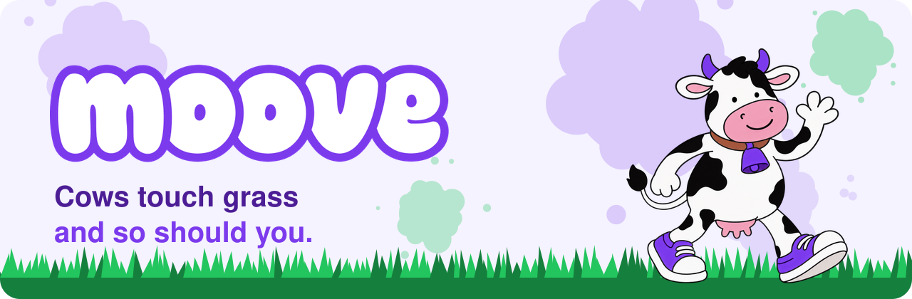
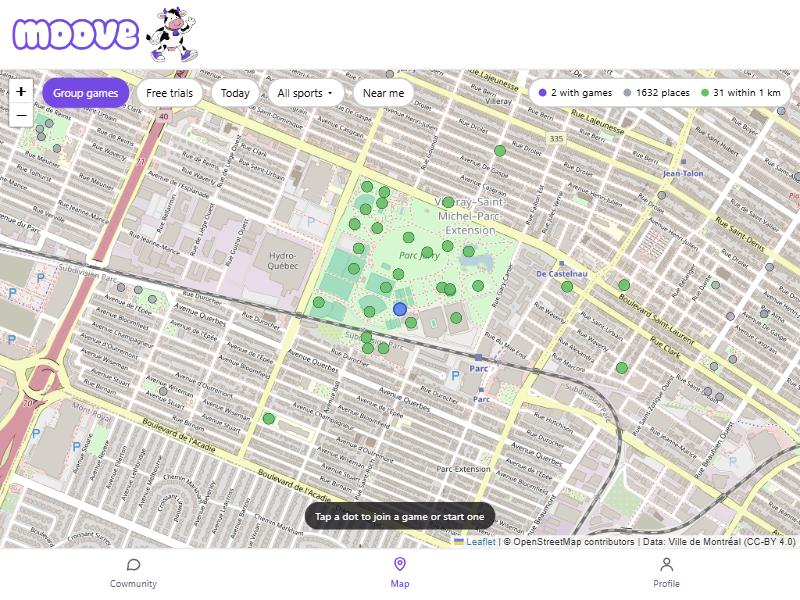
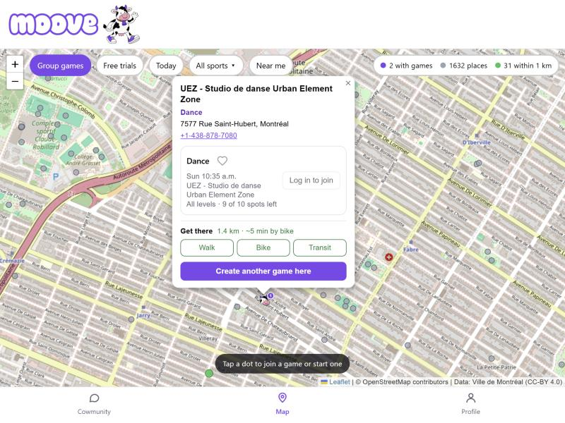
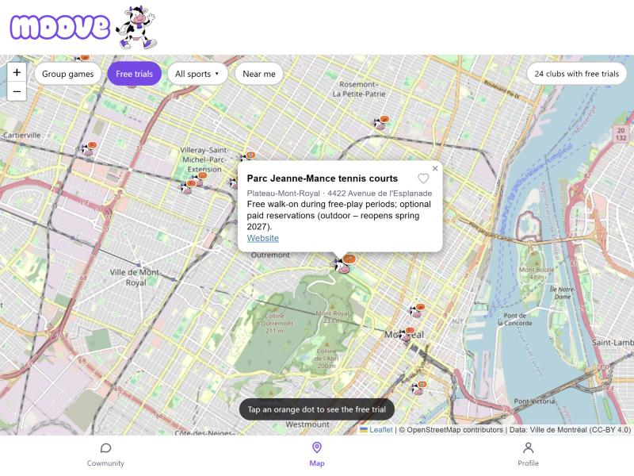
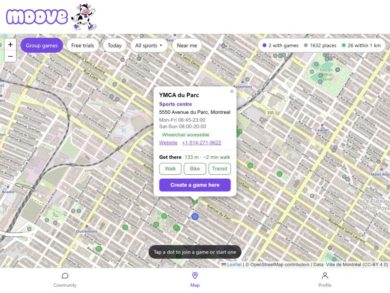
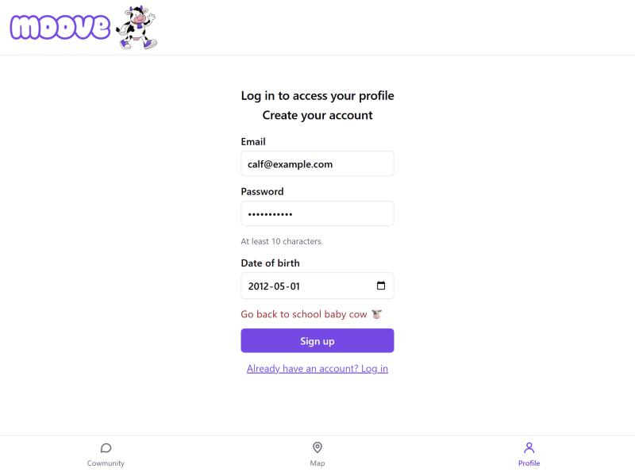

<p align="center">
  
</p>

<h1 align="center">Moove</h1>

<h3 align="center">🐄 Cows touch grass and so should you. 🌱</h3>

<p align="center">
  <b>It's Friday evening. What can I join tonight, near me?</b><br>
  Moove puts every public sports spot in Montréal on one map, so you can find a
  pickup game, join it, or start your own.
</p>

<p align="center">
  
  
  
  
  
  
</p>

---

## 🌱 Why Moove?

Most of Montréal's courts, fields and rinks sit empty on a Friday night, while
plenty of people would play if they only knew where a game was. Moove shows
**where you can play** and **who's playing tonight**, and nudges you to get there
on foot or by bike.

## 🐮 Features

| | |
|---|---|
| 🗺️ **One map, 1,600+ places** | Public courts, fields, rinks and pools from the City of Montréal, plus indoor gyms, arenas, climbing walls and studios from OpenStreetMap. Duplicates on the same field are merged into one dot. |
| 🏐 **Pickup games** | Purple cows are places with upcoming games: tap one to **join** or **leave**. Tap any grey dot to **create a game** there. |
| 🌙 **Today** | One tap hides the empty places and shows only today's games (until 4 a.m., for the late Friday crowd). |
| 🎾 **Free trials** | Clubs offering a free first class (tennis, MMA / BJJ, dance, fencing, boxing), with the same multi-sport filter as games. |
| 🚶 **Get there without a car** | Walk, Bike and Transit buttons open directions. After **Near me**, places within your walking distance turn green. We show no CO₂ numbers on purpose: we have no reliable source for them. |
| 📍 **Place info** | Park name, sports, and for indoor places the address, opening hours, website, phone, free entry and wheelchair access, when the data has them. |
| 👥 **Moomates** | Hosts see who's coming to their games, with names and profile pictures. No emails are ever shared. |
| 🔒 **Accounts** | Sign up with email and password, 18+ only (younger visitors are told to *go back to school, baby cow*). |
| 💬 **Community** | Every upcoming game and posts from other players. Save the games, trials and posts you like as favourites. |
| ⚙️ **Profile & settings** | Your name, picture and favourites, plus your own walking distance and light / dark / device theme. |

The last spot in a game can never be taken twice: the backend checks it inside a
locked database transaction, and spot counts refresh every 5 seconds.

## 📸 A look around

<p align="center">
  <br>
  <sub><b>Near me.</b> Everything within your walking distance turns green.</sub>
</p>

<table>
  <tr>
    <td width="50%" align="center">
      <br>
      <sub><b>Join a game.</b> Spots left, skill level, and how to get there by foot, bike or transit.</sub>
    </td>
    <td width="50%" align="center">
      <br>
      <sub><b>Free trials.</b> Clubs that let you try a first class for free.</sub>
    </td>
  </tr>
  <tr>
    <td width="50%" align="center">
      <br>
      <sub><b>Place info.</b> Address, hours, website and accessibility, when the data has them.</sub>
    </td>
    <td width="50%" align="center">
      <br>
      <sub><b>18+ only.</b> Too young? <i>Go back to school, baby cow.</i> 🐮</sub>
    </td>
  </tr>
</table>

## 🚀 Running it locally

You need **Python 3.10+** and **Node.js 20+**. The app runs as two servers, each
in its own terminal.

### 1. Backend (Python, port 8000)

```powershell
cd backend
python -m venv .venv
.venv\Scripts\Activate.ps1
pip install -r requirements.txt
python seed.py
uvicorn main:app --reload
```

On macOS/Linux, activate the venv with `source .venv/bin/activate` instead.

- `python seed.py` fills the database with fake games starting 2 to 26 hours
  after you run it. Run it again whenever the map shows no games (it wipes
  existing games first).
- **After every `git pull`**, run `pip install -r requirements.txt` again if
  `backend/` changed. A missing package makes the backend hang on startup.
- The API's test page is at http://localhost:8000/docs.

### 2. Frontend (React, port 5173)

```powershell
cd sports-meetup
npm install
npm run dev
```

Open http://localhost:5173. To test as two people on one computer, use a second,
private window and a second account.

### Tests

```powershell
cd backend
pip install pytest httpx
pytest -q
```

## 🧰 Tech stack

| Part | Tech |
|---|---|
| Frontend | React + TypeScript, Vite |
| Map | Leaflet (via react-leaflet), OpenStreetMap tiles |
| Backend | Python, FastAPI |
| Database | SQLite (one file, `backend/sportsmap.db`, created on first run) |
| Accounts | Argon2id password hashes, session cookie |

## 🗂️ Project structure

```
backend/
  main.py           App setup, CORS, routers
  db.py             Database tables, and the locked write transaction
  auth.py           Sign up (18+), log in, log out
  games.py          Games: feed, create, join, leave, cancel, moomates
  user_profile.py   Profile: name, birth year, gender, picture
  posts.py          Community posts
  favorites.py      Favourite games, trials and posts
  seed.py           Fake games for testing

sports-meetup/
  public/
    outdoor_facilities.json  City of Montréal outdoor facilities
    indoor_facilities.json   Indoor facilities from OpenStreetMap
    park_names.json          Park code → park name, for outdoor facilities
  scripts/
    build-park-names.cjs     Rebuilds park_names.json from the city's parks file
  src/
    App.tsx           App shell: header, current page, tab bar
    pages/            One file per tab (Community, Map, Profile); Settings lives in Profile
    auth/             Log-in / sign-up form and session
    features/
      map/            Map, venue dots, filters, popups
      games/          Game cards, create form, moomates list, live refresh
    shared/
      sports.ts       THE sports list used everywhere (see below)
      venues.ts       Loads and merges venues from the data files
      preferences.ts  Settings saved in the browser

docs/
  banner.svg        The banner at the top of this page
  screenshots/      The app screenshots in this README
```

## 🤝 Shared conventions

These are used by every feature, so change them in one place only:

- **Sports** live in `sports-meetup/src/shared/sports.ts`. Code stores and
  compares the `slug` (`basketball`, `outdoor-gym`…) and shows the `label`. The
  `keywords` decide which sport a city facility is, from its name, and the
  `osmTags` do the same for indoor places, from their OpenStreetMap `sport` tag.
- **Venues** have the shape `{ id, name, borough, lat, lng, sports, parkName?, mergedIds?, details? }`.
  The `id` is `mtl:` plus the city's facility ID (for example `mtl:049-0030`) or
  `osm:` plus the OpenStreetMap ID, and games store it as `venue_id`.
- **Spots left** is never stored. The backend computes it as total spots minus
  the number of players.

## 🔌 API

Requests that change data need to be logged in (session cookie).

| Method | Path | Does |
|---|---|---|
| `POST` | `/auth/register` | Sign up: email, password, `birth_date` (`403 under_minimum_age` if under 18) |
| `POST` | `/auth/login` · `/auth/logout` | Log in / out |
| `GET` | `/auth/me` | The logged-in user |
| `GET` | `/games?sports=basketball,soccer` | Upcoming games, soonest first, with `spots_left` |
| `POST` | `/games` | Create a game; the host becomes its first player |
| `POST` · `DELETE` | `/games/{id}/join` | Join (`409 game_full` if no spot is left) / leave |
| `GET` | `/games/{id}/players` | Moomates: who's coming (host only) |
| `DELETE` | `/games/{id}` | Cancel a game (host only, `403 not_host` otherwise) |
| `GET` · `PUT` | `/profile` | Your profile |
| `PUT` · `DELETE` | `/profile/picture` | Upload / remove your picture |
| `GET` · `POST` | `/posts` | Community posts: read / write |
| `DELETE` | `/posts/{id}` | Delete a post |
| `GET` | `/favorites` | Your favourite games, trials and posts |
| `PUT` · `DELETE` | `/favorites/{kind}/{id}` | Add / remove a favourite (`kind` = `game`, `trial` or `post`) |

The full, clickable list is at http://localhost:8000/docs.

## ⚠️ Known limitations

- **The database is local.** Each teammate has their own copy, so a game created
  on one laptop doesn't appear on another unless everyone uses one shared backend.
- **"Live" means polling.** Spot counts refresh every 5 seconds, not instantly.
- **Indoor data is patchy.** OpenStreetMap is crowd-sourced, so some places have
  an address and hours and others only a name.

## 🙏 Data and credits

- Outdoor sports facilities: [Ville de Montréal open data](https://donnees.montreal.ca),
  licence CC-BY 4.0.
- Park names: [Ville de Montréal, Grands parcs, parcs d'arrondissements et espaces publics](https://donnees.montreal.ca/dataset/grands-parcs-parcs-d-arrondissements-et-espaces-publics),
  licence CC-BY 4.0.
- Indoor facilities and map tiles: © [OpenStreetMap](https://www.openstreetmap.org/copyright)
  contributors, Open Database Licence (ODbL).

<p align="center">
  <br>
  <sub>Made with 💜 and a lot of grass in Montréal for CodeJam 2026.</sub>
</p>
